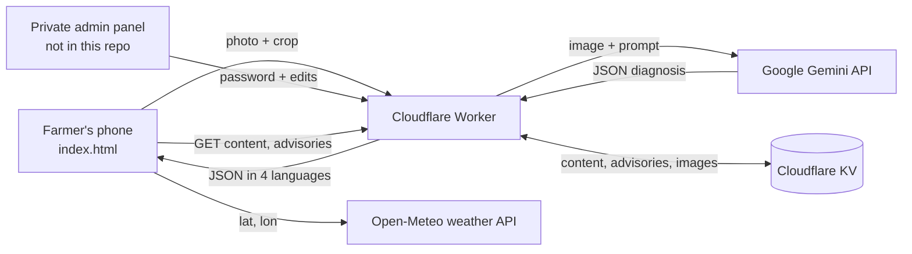

# Technical Design Document: Harud AI

## 1. Overview
Harud AI is a static web app (no build step) with a small serverless backend. The goal is to keep the AI key secret, keep hosting free, and work on low-end phones.

## 2. Architecture

## 3. Components
| Component | Technology | Responsibility |
|---|---|---|
| Farmer app | HTML, CSS, vanilla JS | Scan flow, results, language toggle, voice, history, weather |
| Worker | Cloudflare Workers (JavaScript) | Holds secrets, validates input, calls Gemini, serves content |
| AI model | Google Gemini (vision, JSON output) | Identifies disease and writes advice |
| Storage | Cloudflare KV | Admin text edits, replaced images, advisories |
| Weather | Open-Meteo | Live temperature, humidity, rain, wind |

## 4. Scan flow
1. User picks a crop and uploads or captures a photo.
2. The app sends `{image (base64), mediaType, crop}` to the Worker.
3. The Worker validates type and size (max about 5 MB), builds the prompt and calls Gemini with the secret key.
4. Gemini first checks the photo is a real plant; otherwise it returns a "not a crop photo" message.
5. Otherwise it returns JSON: disease, severity, confidence, cause, treatment, prevention and weather risk in English, Urdu, Hindi and Hinglish.
6. The app renders the result in the chosen language and can read it aloud.

## 5. API (Worker)
| Method and path | Auth | Purpose |
|---|---|---|
| `POST /` | none | Analyze a crop photo |
| `GET /content` | none | Admin text overrides and image versions |
| `GET /img/<key>` | none | Admin-replaced image |
| `GET /advisories` | none | Published advisories |
| `POST /admin/check` | password | Verify admin login |
| `POST /admin/text` | password | Save or reset a text override |
| `POST /admin/image` | password | Replace or reset an image |
| `POST /admin/add`, `/admin/delete` | password | Create or remove an advisory |

## 6. Admin-editable content
Static texts and images in `index.html` carry `data-cms` / `data-cms-img` attributes. On load, the app fetches `/content` and swaps in any overrides, so the built-in content is always the fallback if the Worker is unreachable.

## 7. Security
- Secrets (`GEMINI_API_KEY`, `ADMIN_PASSWORD`) live only in Cloudflare; the repo and browser never contain them.
- Admin routes require the password; image uploads are type- and size-checked.
- User-supplied text is rendered with `textContent` to avoid HTML injection.
- Allowed origin can be restricted in the Worker (`ALLOWED_ORIGIN`).

## 8. Scalability and cost
Static hosting and the Worker run on free tiers. The main limit is the Gemini free-tier rate limit; a paid key or caching can be added later.

## 9. Known limitations
No offline mode yet, diagnosis accuracy not formally benchmarked, no Kashmiri yet, and no user accounts or rate limiting per user.
